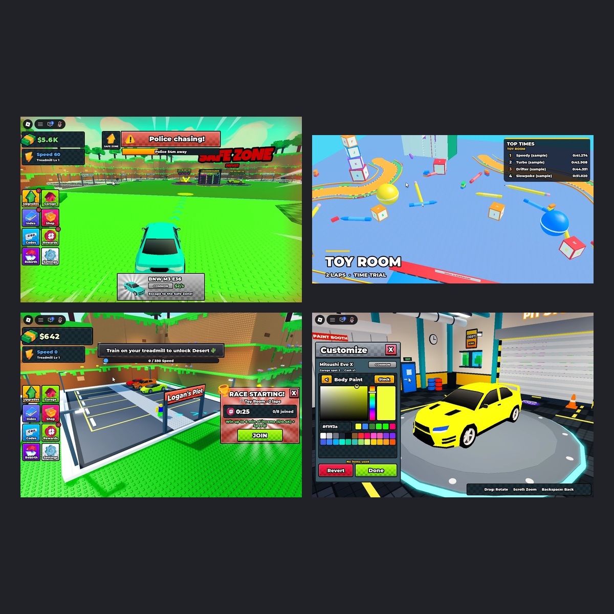
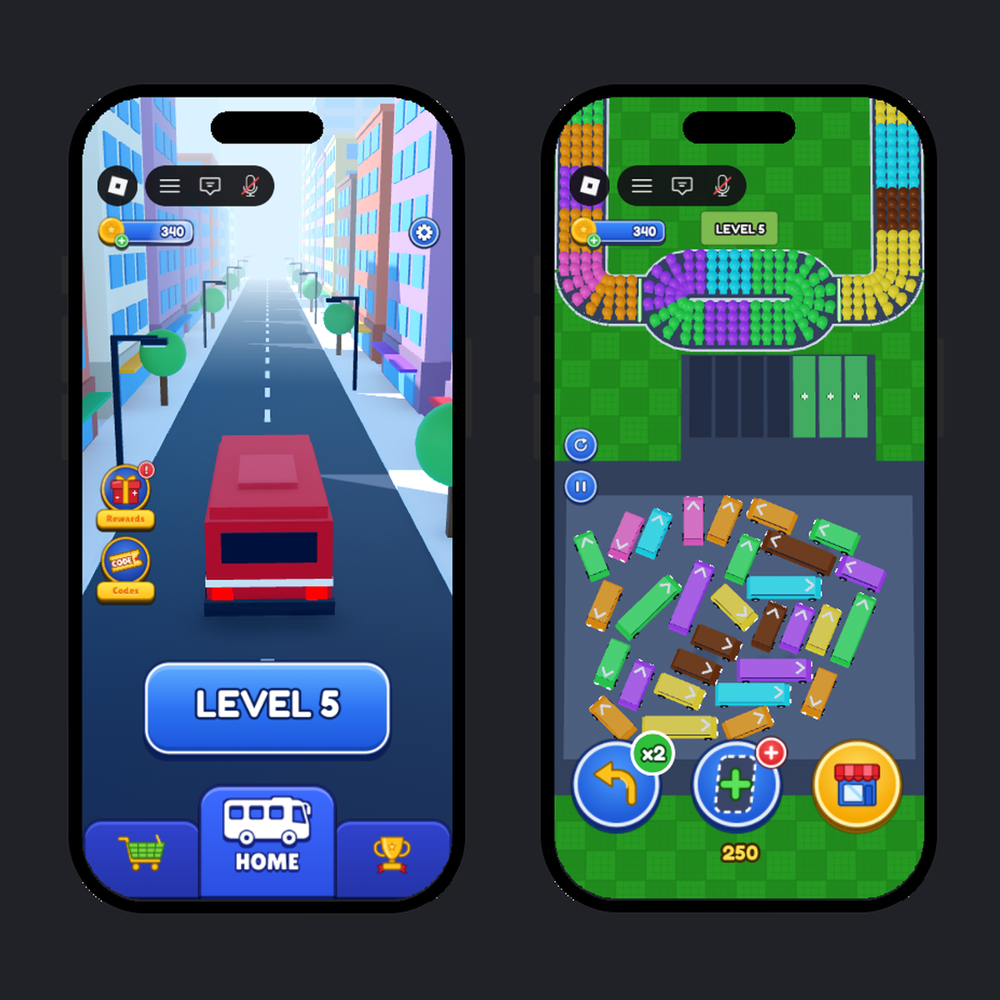
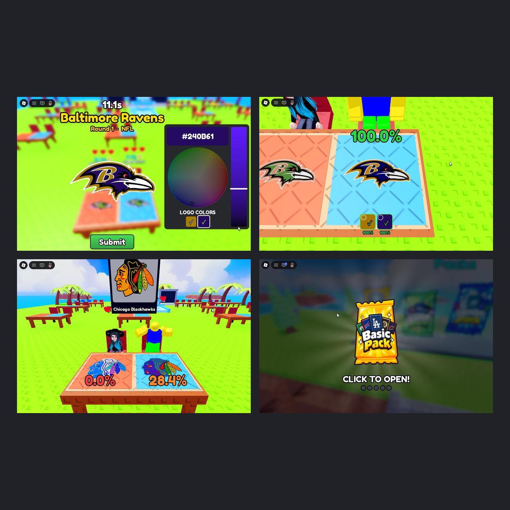

# Hi, I'm Logan (Dude7271)
### Roblox developer since 2020 & third-year CS student at UNB (graduating May 2028)

I am a Computer Science student and developer specializing in **backend systems**, **modular architecture**, and **secure data management** on Roblox. I treat game development with the same rigor as software engineering, utilizing professional workflows (Rojo, Git) to build scalable, maintainable codebases.

---

## Technical Skills

| **Languages** | **Frameworks & Libraries** | **Tools & Workflow** |
| :--- | :--- | :--- |
|  **Luau** | **ProfileStore** (Data) | **Rojo** (External Sync) |
|  **Java** | **DataStore2** (Legacy Data) | **Git / GitHub** |
|  **C / C++** | **Modular Architecture** | **Visual Studio Code** |
|  **Python** |  | **Wally** (Package Manager) |
| | **Roblox Open Cloud API** | **Selene** (Linting) |

---

## Featured Games

### Steal a Supercar! (sold to a development firm)
A 3D multiplayer car-stealing tycoon built from scratch with Rojo.
* **Gameplay:** driving and races, police chase AI that pursues players out of each zone, and ragdoll physics, using raycasts and local/world space transforms.
* **Backend:** 30+ server services (ProfileStore saves, economy, rebirths, races, daily rewards, analytics) with rate-limited networking and an in-engine unit test runner.
* **Outcome:** the game was sold to a development firm.

### Depot Dash
A colour-matching bus puzzle game.
* **Collision detection:** vehicles sit at any angle; the separating axis theorem and swept-path checks decide whether a vehicle's way ahead is clear.
* **Level generation:** a seeded generator that always produces solvable levels, with game rules shared by client and server.
* **Tools:** a Studio-only level editor (drag, rotate, box-select) that is never sent to players.

### Color the Sports Team
A 1v1 multiplayer game: fix the scrambled colours of a sports team logo more accurately than your opponent.
* **Asset pipeline:** Python scripts vectorize logos, split them into colour layers and upload all 429 layers through the Roblox Open Cloud API.
* **Grading:** colour accuracy scored with the CIEDE2000 colour-difference formula, verified against published test data, and weighted by each part's visible area.

### [EXTRA HARD OBBY](https://www.roblox.com/games/4986072211/EXTRA-HARD-OBBY)
* **Role:** builder and scripter on an obstacle course game with **3.5 million+ visits** and **11,000+ favourites**, designing levels around player movement and difficulty.
* **Stage Persistence:** Uses `DataStore2` for ultra-reliable saving of stage progress and death counts.
* **Discord Integration:** Features a `DiscModule` to send Webhook notifications to a Discord server when players reach milestones or join the game.
* **Custom Intro UI:** A fully scripted camera intro sequence with tweened UI elements for a polished user experience.

---

## Earlier Projects

### Custom Placement Tycoon System (OOP)
A highly scalable Tycoon framework that allows for easy addition of new objects without rewriting core logic.
* **Core Mechanics:** Handles Spawners, Conveyors, Upgraders, and Collectors as distinct classes inheriting from a base `Object` class.
* **Logic System:** Includes a `LogicHandler` for "Wire" and "Gate" objects, allowing players to build complex logic circuits (AND/OR/XOR) to automate their tycoons.
* **Placement Validation:** Grid-based placement system (`PlacementValidator`) that handles rotation, collision detection, and plot boundaries.

### Simulator Economy & Inventory Backend

A robust backend for a collection-style simulator game. Designed to handle secure transactions and inventory syncing.
* **Data Management:** Utilizes a custom wrapper for `DataStoreService` to handle complex player profiles, including "Berries Collected," "Items Owned," and "Areas Unlocked".
* **Shop Architecture:** Server-authoritative purchase validation system (`MarketplaceService` integration) that prevents exploiters from acquiring items without currency.
* **Analytics:** Integrated `AnalyticsManager` to track economy sinks and sources (Gold earned vs. Gold spent) to balance the game economy.

### Procedural Terrain Generator
A script utilizing **Perlin Noise** (`math.noise`) to generate infinite, chunk-based terrain.
* **Biome Logic:** Automatically assigns materials (Sand, Grass, Slate) and colors based on the Y-level height map.
* **Asset Population:** Procedurally spawns trees and vegetation based on seed randomization, ensuring a unique map every time.

---

## 📬 Contact
* **Roblox:** Dude7271
* **Discord:** logank.280
---
